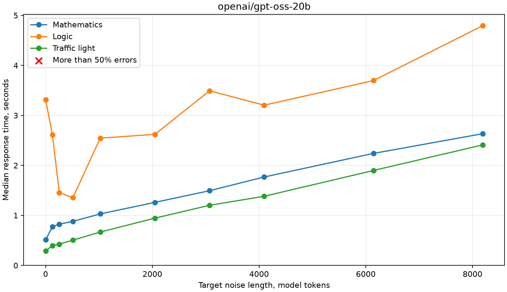
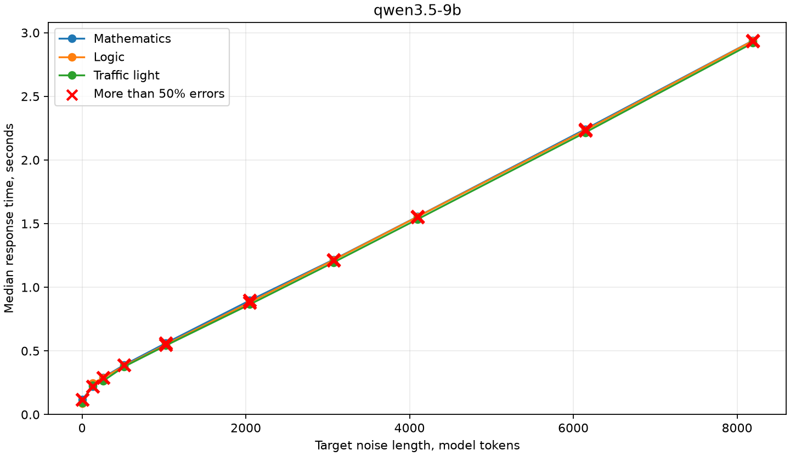
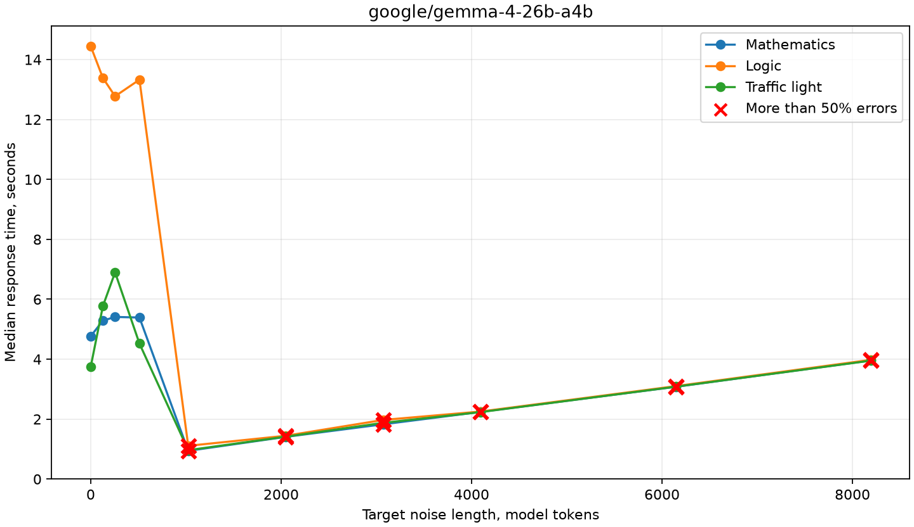

[🇷🇺 **Русская версия / Russian version**](README_ru.md)

# LLM Stability Lab: research report

## Hardware

The models run locally in LM Studio through an OpenAI-compatible API. Experiments are sequential: one request at
a time.

- CPU: AMD Ryzen 7 9700X.
- GPU: NVIDIA GeForce RTX 4060 Ti with 16 GB VRAM.
- System RAM: 64.0 GB, of which 61.6 GB is available.
- Model server: LM Studio.

## Models

The study tests these model variants:

| Model | Quantization |
| --- | --- |
| `openai/gpt-oss-20b` | MXFP4 |
| `qwen3.5-9b` | Q6_K |
| `google/gemma-4-26b-a4b` | Q4_K_M |

## Performance

The table shows the time taken by the full experiment 01–05 runs. Each plan contains 621 requests across three
tasks. Response time includes the server request and generation; medians use successful requests.

| Model | Run time | Median response time |
| --- | ---: | ---: |
| `openai/gpt-oss-20b` | about 10 min 54 s | 0.55 s |
| `qwen3.5-9b` | about 1 min 24 s | 0.14 s |
| `google/gemma-4-26b-a4b` | about 1 h 32 min | 5.37 s |

Gemma 4 26B A4B does not fit entirely in GPU memory: some of its experts are placed on the CPU. This matters when
comparing speed. The models also generate different numbers of tokens, including reasoning tokens, so response
times do not directly compare token-generation speed.

## Tasks

The tasks were deliberately chosen to be simple: the goal is to see how noise and other changes to a request can
affect model answers even on straightforward tasks.

The study uses three tasks. Their original English wording is shown below without noise. In the experiments,
irrelevant text is added or the answer choices are reordered while preserving the task's meaning and conditions.
Line breaks inside the English paragraphs are added for readability.

### 1. Mathematics

A problem about counting the remaining bottles after sales, a delivery, and breakage.

> A store has 4 boxes containing 18 bottles of water each. During the morning, 23 bottles are sold.
> Later, 2 additional packages containing 12 bottles each are delivered. By the evening, 7 bottles
> have been broken.
>
> How many intact bottles remain in the store?

**Answer format:** only an integer, without an explanation.

### 2. Logic

A problem about identifying the contents of a box using deliberately incorrect labels and one drawn item.

> There are three closed boxes in a warehouse. One contains only tea bags, another contains only
> coffee packets, and the third contains a mixture of tea bags and coffee packets. The boxes are
> labeled "Tea", "Coffee", and "Tea and Coffee". All three labels are incorrect. A worker
> takes one item from the box labeled "Tea and Coffee". It is a tea bag.
>
> What is inside the box labeled "Coffee"?
>
> Answer choices:
>
> 1. Tea only
> 2. Coffee only
> 3. A mixture of tea and coffee
> 4. Not enough information to determine

**Answer format:** only the number of the chosen option, without an explanation.

### 3. Everyday knowledge

A question about a pedestrian traffic light under ordinary conditions.

> You are standing at a pedestrian crossing controlled by a working pedestrian traffic light. The
> signal displays exactly one steady color. Assume ordinary pedestrian traffic-light rules, with no
> traffic officer or special instructions.
>
> Which signal color permits a pedestrian to start crossing?
>
> Answer choices:
>
> 1. Green
> 2. Red
> 3. Yellow
> 4. Purple
> 5. White
> 6. Black
> 7. Blue
> 8. Pink
> 9. Turquoise

**Answer format:** only the number of the chosen option, without an explanation.

The choices above are in their original order. In the reordering experiments, the model still returns a number;
evaluation identifies the meaning of the option at that number in the particular request.

## Experiment 01. Determinism

We check whether a model changes its answer when the same request is repeated. Each model receives each of the
three tasks sequentially 100 times, with identical messages and `temperature=0`. Requests are independent and
do not contain previous answers.

Every model consistently repeated the same answer to each task. Qwen, however, got the mathematics problem wrong
every time: answer stability alone does not imply correctness. The result applies to these three tasks and the
conditions of this run.

## Experiment 02. Noise position

Short sequences of unrelated words were inserted before the task, between the description and the question, or
after the question. A clean request was used for comparison. Three noise texts were tested in each position.
These were sequences of unrelated English words rather than meaningful sentences: two had eight words and one
had seven. An example is `violet lantern copper meadow orbit velvet cinnamon telescope`. Token counts depend on
the model tokenizer; the noise length in tokens was not measured separately for this experiment.

GPT-OSS answered every case correctly. Gemma answered all received responses correctly; one mathematics request
ended in an API error. Qwen answered the logic and traffic-light tasks correctly, but got the mathematics task
wrong in every variant, including the clean request. Its numeric answer changed with noise but remained incorrect.

## Experiment 03. Changes in wording and noise

The original tasks were compared with variants containing unrelated words, irrelevant sentences, different
amounts of text, and neutral wording changes.

GPT-OSS answered all variants correctly. Gemma answered all received responses correctly; one mathematics
request ended in an API error. Qwen again got every mathematics variant wrong and made two errors on the logic
task; it made no errors on the traffic-light task.

## Experiment 04. Answer-choice order

The logic task was tested with all 24 permutations of its choices; the traffic-light task used 90 permutations.
Evaluation considered the meaning of the selected option, not just its displayed number. Higher is better.

| Model | Logic accuracy | Traffic-light accuracy |
| --- | ---: | ---: |
| GPT-OSS 20B | 100% | 100% |
| Qwen 3.5 9B | 33% | 100% |
| Gemma 4 26B | 100% | 100% |

In this experiment, answer order noticeably affected Qwen's response to the logic task.

## Experiment 05. Noise and answer order

We tested the combination of noise and reordered choices: original and shuffled orders were compared with and
without noise. The experiment used the logic and traffic-light tasks.

GPT-OSS made six logic errors, all with noise. Qwen made no errors with the original order but frequently made
errors with shuffled choices, both with and without noise. Gemma answered all cases correctly. All three models
solved the traffic-light task without errors.

## Experiment 06. Noise length

For the logic and traffic-light tasks, we increased the amount of unrelated text while also changing its position
and the order of answer choices. Target lengths were 0, 256, 1024, 4096, and 8192 tokens, measured using each
model's tokenizer. Each model, task, and length had six requests: three positions and two answer orders. The
context limit was 18,000 tokens, with a 2048-token generation reserve.

There were no errors on the traffic-light task. The table shows the error rate on the logic task; lower is better.

| Model | No noise | 256 | 1024 | 4096 | 8192 |
| --- | ---: | ---: | ---: | ---: | ---: |
| GPT-OSS 20B | 0% | 0% | 0% | 0% | 17% |
| Qwen 3.5 9B | 50% | 50% | 50% | 67% | 67% |
| Gemma 4 26B | 0% | 0% | 33% | 83% | 100% |

Qwen made errors even without noise under the tested permutations. In this pilot, Gemma made more errors with
larger amounts of noise. The results come from one logic problem and do not demonstrate general model robustness.

### Response time and noise length

The benchmark covers all three tasks and ten noise lengths. Each point is the median of three medians: in each
round, five requests were measured after one warmup request. Time includes the server request and generation.
Each chart uses its own time scale.

A red cross marks a point where more than half the responses for the corresponding task were incorrect.
Malformed and truncated responses are also counted. Lines may overlap when their values are close.







Qwen made errors in more than just mathematics. It never answered the mathematics task correctly, even without
noise. It made no logic errors without noise, but errors became more frequent as noise increased: 2 of 15 answers
at 256 tokens, 4 of 15 at 512, 10 of 15 at 1024, and all 15 from 2048 onward. Qwen answered the traffic-light
task correctly in every case. A cross appears only when more than half the answers are errors; nearby lines may
overlap on the chart.

In one run, Gemma responded much faster with long noise. For example, on the logic task its generated token count
fell from 721 without noise to 6 with 8192 noise tokens, but the answer changed to an incorrect one.

The most illustrative Gemma results for the logic task are:

- No noise: median 14.45 s, 0 errors out of 15.
- 1024 noise tokens: median 1.11 s, 15 errors out of 15.

Each point on the final chart is the median of three medians of five requests each.

## Difficult-noise selection

Two rounds sought text that caused errors. In the second round, 15 variants at several lengths were tested for
each model, and the variant with the most errors in preliminary screening was selected. Three new texts and three
previously selected texts were then tested on all models using the logic and traffic-light tasks.

The total error rate across the six texts was about 3% for GPT-OSS, 33% for Qwen, and 17% for Gemma; lower is
better. Some Qwen errors also occurred without noise. Selection and testing used few task variants, so the results
describe these requests and do not establish the general robustness of the models.

## Preliminary findings

This is a quick test of only three relatively easy tasks. The models performed best on the everyday-knowledge
task: the traffic-light problem was the easiest for these models. Qwen 9B began making mistakes most readily,
although it was fast.

### Gemma with a large amount of noise

At 512 noise tokens, Gemma solved all 15 mathematics requests and made one error on the logic task. At 1024 noise
tokens, it got all 15 answers wrong on each of these two tasks.

The server marked these responses as normally completed (`finish_reason: stop`), so they do not appear to have
been cut off by the token limit. The number of generated tokens nevertheless fell sharply: on the logic task, the
median dropped from 616 at 512 noise tokens to 6 at 1024. The records do not establish what changed inside the
model or server.

## Main takeaway

Even if a model **solves your test problem correctly 10 times in a row**, it can still make a mistake on the same
problem solely because the surrounding text—the context unrelated to the solution—has changed.

**Main conclusion:** setting up an AI agent and successfully testing it does not guarantee correct operation in
real conditions. Errors can occur even if you **change nothing** in the model, its settings, or the agent's code.
It can be enough for the context in which it performs the same task to change.

---

# Framework setup and usage

A small, reproducible pilot framework for measuring how answers change under repeated requests, irrelevant
context, harmless wording changes, and multiple-choice answer shuffling. Prompts and reports are in English;
CLI logs are in English.

The complete English research report, including experiment results and links to the local raw data, is in
[raw_report.md](raw_report.md). A Russian-language report is available in [README_ru.md](README_ru.md).

## Setup

Use Python 3.11 or newer. In PowerShell:

```powershell
py -3.11 -m venv .venv
.\.venv\Scripts\python.exe -m pip install -e ".[dev]"
```

Edit `configs/default.yaml` to match the endpoint and exact model ID exposed by LM Studio. The default endpoint is
`http://192.168.0.109:1234/v1` and the selected model ID is `openai/gpt-oss-20b`. The application lists available
IDs and reports a mismatch; it never silently selects another model. It does not download models.

All implementation modules live directly under `src\`. The editable package mapping keeps the documented
`python -m llm_stability_lab` command available without a nested source directory.

## Commands

```powershell
# List model IDs reported by /v1/models
python -m llm_stability_lab models

# Preview the default plan and a few rendered prompts without sending requests
python -m llm_stability_lab plan

# Print every request and prompt in the plan
python -m llm_stability_lab plan --preview-all

# Run a small deterministic debugging sample
python -m llm_stability_lab run --experiment 01 --task task_01_math --repetitions 2

# Override the model ID and experimental seed
python -m llm_stability_lab run --experiment 04 --model "server-exposed-model-id" --seed 73

# Send one request to LM Studio and save its response
python -m llm_stability_lab smoke --task task_01_math

# Run all five experiments with the configured defaults
python -m llm_stability_lab run

# Resume an interrupted run with the same options
python -m llm_stability_lab run --resume RUN_ID

# Build reports from a saved run ID or a JSONL file path
python -m llm_stability_lab report RUN_ID
```

`run` is the only command that launches a full experiment plan. Its default plan contains 621 inference calls:
300 for determinism and 321 across the remaining four experiments. Review `plan` before a full run. Override the
selected experiment, task list, repetition count, permutation count, or interaction block count from the CLI.

## Experiments

| ID | Experiment | Design |
| --- | --- | --- |
| 01 | Determinism | Repeats the same stateless prompt 100 times per task by default. |
| 02 | Position sensitivity | Compares clean prompts with three fixed noise samples at three insertion positions. |
| 03 | Reasoning stability | Uses unrelated words, irrelevant sentences, neutral wording, and varied noise lengths. |
| 04 | Answer-order sensitivity | Tests all 24 logical-task orders and 90 balanced traffic-task orders by default. |
| 05 | Noise x answer order | Matched clean/noisy and original/shuffled conditions with balanced positions. |
| 06 | Noise length x answer order | Measures errors across configurable lengths using the selected model tokenizer. |

Experiment 06 is selected explicitly, so the default `run` still executes experiments 01–05. It uses a clean
baseline and noise targets of 256, 1,024, 4,096, and 8,192 model tokens. By default, each level uses the same repeated
word sequence, and each block matches original and shuffled answer orders across lengths. With one block there is
one noise position and one shuffled order per task; use more blocks to cover positions and answer orders.

```powershell
python -m llm_stability_lab plan --experiment 06 --model google/gemma-4-26b-a4b --interaction-blocks 1
python -m llm_stability_lab run --experiment 06 --model google/gemma-4-26b-a4b --interaction-blocks 1
```

Planning experiment 06 connects to the LM Studio SDK and may load the selected model. The SDK tokenizes the actual
noise and formatted chat. The configured context limit is 18,000 tokens, including the `max_tokens` generation
reserve (2,048 by default) and an extra 64-token template margin. Server-reported input token counts are saved for
comparison. Configure `experiment_6_noise_levels` and `experiment_6_context_limit` in the YAML file. The default
18 blocks produce 360 requests across both tasks; the one-block command above produces 20 requests. Set
`experiment_6_noise_variant` to `random_words`, `sentences`, or `catalog` to generate other reproducible noise;
`experiment_6_noise_seed` controls its random seed independently of answer order. Set `experiment_6_noise_file`
to a JSON mapping from target lengths to exact text to reuse the same noise across models. Each model measures that
text with its own tokenizer; noise above 8,192 tokens is rejected.

Correctness is evaluated locally. Multiple-choice answers map to stable semantic choice IDs, so a changed displayed
number does not count as a changed answer when it still names the same choice. Temperature zero is sent explicitly.
If the API rejects a requested parameter, the failed request and traceback are saved; there is no fallback to a
different setting. SDK retries default to zero.

## Results and interpretation

Each run receives a unique ID. Raw JSONL is appended after every request under `results/raw/`; run configuration and
plan hashes are saved under `results/runs/`; logs are under `results/logs/`. Resume validates the saved settings and
plan and skips every case already recorded, including failed requests. Reports are written to a new timestamped
directory under `results/reports/` with CSV tables, Markdown results, and PNG charts.

This is a small pilot with three hand-written tasks. Repeated calls and prompt variants are not independent reasoning
problems. The report keeps task-level results separate and omits cluster-bootstrap intervals when there are too few
independent task clusters. Results do not establish general model robustness. The API response can report the
selected model and available usage, but an accepted request does not prove that the backend applied every requested
generation setting exactly.

## Tests

Run mocked unit tests without a server:

```powershell
.\.venv\Scripts\python.exe -m pytest
```

The tests cover task answers, answer permutations, perturbation reproducibility, evaluation, case planning,
incremental JSONL persistence, resume validation, reporting, and mocked inference. A live `smoke` command is
optional and sends one prompt to the configured server.

To enable the separate live integration test explicitly:

```powershell
$env:LLM_STABILITY_LAB_INTEGRATION = "1"
.\.venv\Scripts\python.exe -m pytest tests/test_lm_studio_integration.py
```
