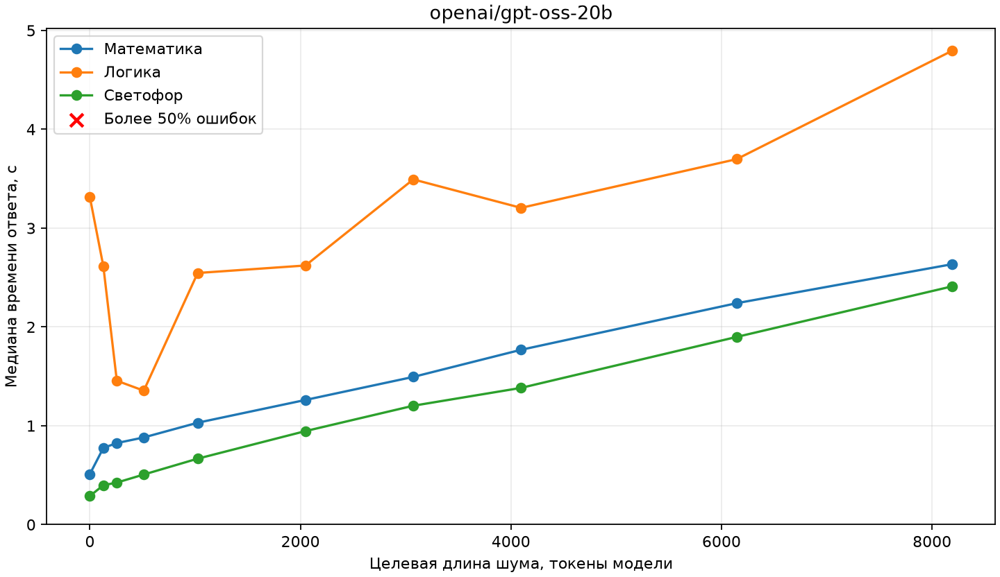
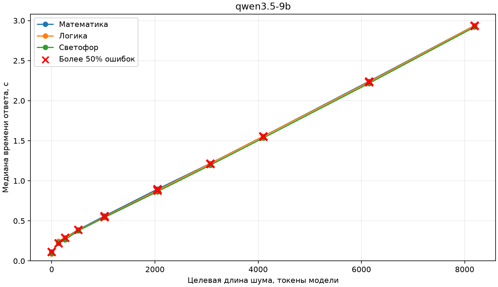
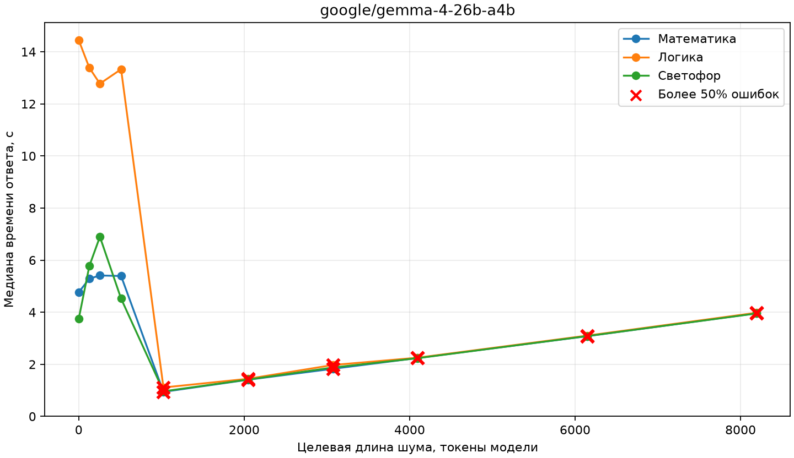

# LLM Stability Lab: отчёт об исследовании

## Оборудование

Модели выполняются на локальном LM Studio
через OpenAI-совместимый API. Эксперименты проводятся последовательно: один запрос за раз.

- Процессор: AMD Ryzen 7 9700X .
- Видеокарта и объём видеопамяти: NVIDIA GeForce RTX 4060 Ti (16 ГБ).
- Объём оперативной памяти сервера: 64.0 ГБ (доступно: 61.6 ГБ).
- Сервер моделей: LM Studio.

## Модели

В исследовании проверяются следующие версии моделей:

| Модель | Квантование |
| --- | --- |
| `openai/gpt-oss-20b` | MXFP4 |
| `qwen3.5-9b` | Q6_K |
| `google/gemma-4-26b-a4b` | Q4_K_M |

## Быстродействие

Ниже приведено время полных прогонов экспериментов 01–05. В каждом плане — 621 запрос на трёх задачах;
время ответа включает обращение к серверу и генерацию. Медиана рассчитана по успешным запросам.

| Модель | Время прогона | Медианное время ответа |
| --- | ---: | ---: |
| `openai/gpt-oss-20b` | около 10 мин 54 с | 0,55 с |
| `qwen3.5-9b` | около 1 мин 24 с | 0,14 с |
| `google/gemma-4-26b-a4b` | около 1 ч 32 мин | 5,37 с |

Gemma 4 26B A4B целиком не помещается в видеопамять: часть экспертов размещена на CPU.
Это важно учитывать при сравнении скорости. Модели также генерируют разное количество токенов, включая токены
рассуждения, поэтому приведённое время ответа не является прямым сравнением скорости генерации токенов.

## Задачи

Задачи намеренно выбраны несложными: цель — увидеть, как меняется качество ответов моделей под влиянием
шума и других изменений запроса даже на простых задачах.

В исследовании используются три задачи. Ниже приведены исходные формулировки на английском языке без шума.
В экспериментах текст дополняется шумом или изменяется порядок вариантов; смысл и условия задач сохраняются.
Переносы строк внутри английских абзацев добавлены для удобства чтения.

### 1. Математика

Задача на подсчёт оставшегося количества бутылок после продажи, поставки и потерь.

> A store has 4 boxes containing 18 bottles of water each. During the morning, 23 bottles are sold.
> Later, 2 additional packages containing 12 bottles each are delivered. By the evening, 7 bottles
> have been broken.
>
> How many intact bottles remain in the store?

**Форма ответа:** только целое число, без объяснения.

### 2. Логика

Задача на определение содержимого коробки по заведомо неверным надписям и одному извлечённому предмету.

> There are three closed boxes in a warehouse. One contains only tea bags, another contains only
> coffee packets, and the third contains a mixture of tea bags and coffee packets. The boxes are
> labeled "Tea", "Coffee", and "Tea and Coffee". All three labels are incorrect. A worker
> takes one item from the box labeled "Tea and Coffee". It is a tea bag.
>
> What is inside the box labeled "Coffee"?
>
> Answer choices:
>
> 1. Tea only
> 2. Coffee only
> 3. A mixture of tea and coffee
> 4. Not enough information to determine

**Форма ответа:** только номер выбранного варианта, без объяснения.

### 3. Повседневные знания

Задача о сигнале пешеходного светофора в обычных условиях.

> You are standing at a pedestrian crossing controlled by a working pedestrian traffic light. The
> signal displays exactly one steady color. Assume ordinary pedestrian traffic-light rules, with no
> traffic officer or special instructions.
>
> Which signal color permits a pedestrian to start crossing?
>
> Answer choices:
>
> 1. Green
> 2. Red
> 3. Yellow
> 4. Purple
> 5. White
> 6. Black
> 7. Blue
> 8. Pink
> 9. Turquoise

**Форма ответа:** только номер выбранного варианта, без объяснения.

Порядок вариантов выше — исходный. В экспериментах с перестановкой модель также возвращает номер, а проверка
определяет, какой смысловой вариант соответствует этому номеру в конкретном запросе.

## Эксперимент 01. Детерминизм

Проверяем, меняется ли ответ модели при повторении одного и того же запроса. Каждая модель последовательно
получает каждую из трёх задач 100 раз с одинаковыми сообщениями и параметром `temperature=0`.
Запросы независимы и не содержат историю предыдущих ответов.

Все модели в эксперименте стабильно повторяли одинаковый ответ на каждую задачу. При этом Qwen каждый раз ошибалась в математической
задаче: стабильность ответа сама по себе не означает его правильность. Результат относится к этим трём задачам
и условиям запуска.

## Эксперимент 02. Положение шума

К задачам добавлялись короткие посторонние слова: перед условием, между условием и вопросом или после вопроса.
Для сравнения использовался запрос без шума. Проверялись три текста шума в каждой позиции.
Это были наборы не связанных с задачами английских слов, без осмысленных предложений: два набора по восемь слов
и один из семи. Например: `violet lantern copper meadow orbit velvet cinnamon telescope`.
Число токенов зависит от токенизатора модели; в этом эксперименте длина в токенах отдельно не измерялась.

GPT-OSS отвечала правильно во всех случаях. Gemma правильно ответила на все полученные ответы; один запрос
к математической задаче завершился ошибкой API. Qwen правильно отвечала на логическую задачу и задачу про светофор,
но ошибалась в математической во всех вариантах, включая исходный запрос. Сам числовой ответ при добавлении шума
менялся, хотя оставался неправильным.

## Эксперимент 03. Изменения формулировки и шума

Сравнивались исходные задачи и их варианты с посторонними словами, предложениями, разным количеством
текста и нейтральными изменениями формулировки.

GPT-OSS ответила правильно во всех вариантах. 
Gemma правильно ответила на все полученные ответы; один запрос
к математической задаче завершился ошибкой API. 
Qwen снова ошиблась во всех вариантах математической задачи,
а на логической задаче допустила две ошибки; задачу про светофор решила без ошибок.

## Эксперимент 04. Порядок вариантов ответа

В логической задаче проверялись все 24 перестановки вариантов ответа, а в задаче про светофор — 90 перестановок.
При оценке учитывался смысл выбранного варианта, а не только его номер (больше -- лучше).

| Модель | Логическая задача: правильность | Светофор: правильность |
| --- | ---: | ---: |
| GPT-OSS 20B | 100% | 100% |
| Qwen 3.5 9B | 33% | 100% |
| Gemma 4 26B | 100% | 100% |

В этом эксперименте порядок вариантов заметно влиял на ответ Qwen в логической задаче.

## Эксперимент 05. Шум и порядок ответов

Проверялось сочетание шума и перестановки вариантов: исходный и изменённый порядок сравнивались с шумом
и без него. В эксперименте участвовали логическая задача и задача про светофор.

На логической задаче GPT-OSS допустила шесть ошибок, все с шумом. Qwen не ошибалась при исходном порядке,
но часто ошибалась при перестановках как с шумом, так и без него. Gemma ответила правильно во всех случаях.
Задачу про светофор все три модели решили без ошибок.

## Эксперимент 06. Длина шума

Для логической задачи и задачи про светофор увеличивали объём постороннего текста, меняя также его позицию
и порядок вариантов ответа. Целевые длины: 0, 256, 1024, 4096 и 8192 токена по токенизатору каждой модели.
На каждую модель, задачу и длину приходилось шесть запросов: три позиции и два порядка ответов.
Лимит контекста составлял 18 000 токенов с резервом 2048 токенов на генерацию.

На задаче про светофор ошибок не было. Ниже — доля ошибок (меньше -- лучше) в логической задаче:

| Модель | Без шума | 256 | 1024 | 4096 | 8192 |
| --- | ---: | ---: | ---: | ---: | ---: |
| GPT-OSS 20B | 0% | 0% | 0% | 0% | 17% |
| Qwen 3.5 9B | 50% | 50% | 50% | 67% | 67% |
| Gemma 4 26B | 0% | 0% | 33% | 83% | 100% |

У Qwen ошибки встречались уже без шума, при проверенных перестановках. В этом пилоте Gemma чаще ошибалась
при больших объёмах шума; результаты получены на одной логической задаче и не показывают общую устойчивость модели.

### Время ответа и длина шума

Бенчмарк охватывает все три задачи и десять длин шума. Каждая точка — медиана трёх медиан:
в каждом круге измерялись пять запросов после одного прогревочного. Время включает обращение к серверу
и генерацию. Шкала времени на каждом графике своя.
Красный крестик отмечает точку, в которой ошибочными оказались более половины ответов по соответствующей задаче.
Учитываются также ответы с нарушением формата или обрезанные ответы. При близких значениях линии могут перекрываться.

Qwen ошибалась не только в математике. В математической задаче она не дала ни одного правильного ответа,
даже без шума. В логической задаче без шума ошибок не было, но с увеличением шума они участились:
при 256 токенах — 2 из 15 ответов, при 512 — 4 из 15, при 1024 — 10 из 15, а начиная с 2048 — все 15.
На задаче про светофор Qwen ответила правильно во всех случаях. Крестик появляется только при ошибках более чем
в половине ответов, а близко расположенные линии на графике могут перекрываться.

В одном прогоне Gemma при длинном шуме отвечала значительно быстрее. Например, в логической задаче число
токенов генерации сократилось с 721 без шума до 6 при 8192 токенах шума, но ответ изменился на неправильный!

На итоговом графике точка — медиана трёх медиан по пяти запросам. 

## Подбор трудного шума

Проведены два раунда подбора текста, вызывающего ошибки. Во втором для каждой модели проверили 15 вариантов
на нескольких длинах и выбрали вариант с наибольшим числом ошибок при предварительной проверке. Затем три новых
и три прежних текста проверили на всех моделях, используя логическую задачу и задачу про светофор.

Суммарная доля ошибок на шести текстах составила около 3% у GPT-OSS, 33% у Qwen и 17% у Gemma (меньше -- лучше).
У Qwen часть ошибок возникала и без шума. Отбор и проверка проводились на небольшом числе вариантов задач,
поэтому результаты описывают именно эти запросы и не устанавливают общую устойчивость моделей.

