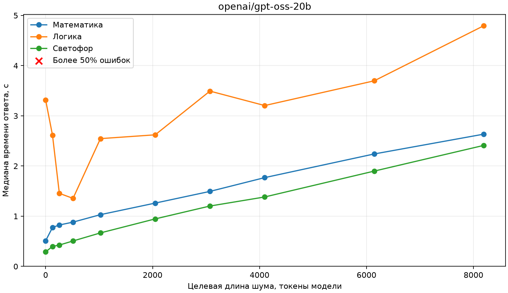
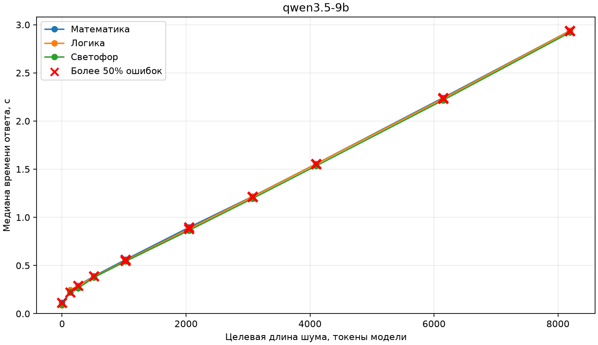
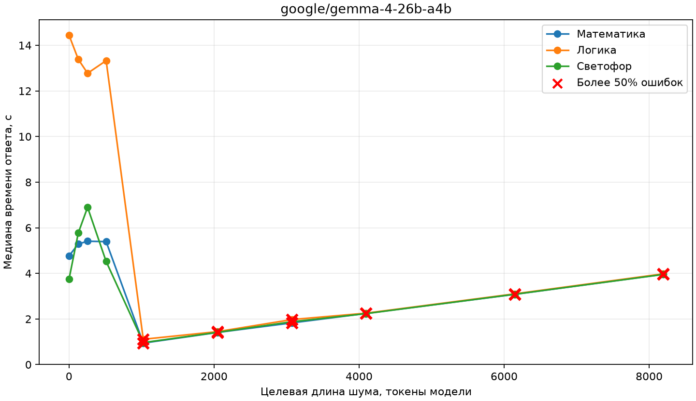

# LLM Stability Lab: research report

## Scope and interpretation

This pilot examines answer stability under repeated requests, irrelevant text, harmless prompt changes, and
answer-order changes. It uses three intentionally simple, hand-written tasks. Repeated calls and variants are not
independent reasoning problems, so these results do not establish general model robustness.

This report covers the completed experiments and the separate latency benchmark. Exact prompts, model responses,
timings, token usage and run settings are retained in the local JSONL and metadata files linked below. These files
and the generated charts are under `results/`, which is ignored by Git and may not exist in another checkout.

## Hardware, models and execution

The measurements were made through a local LM Studio server on an AMD Ryzen 7 9700X with 64 GB system RAM and an
NVIDIA GeForce RTX 4060 Ti with 16 GB VRAM. The model variants and quantization, as provided by the operator, were:

| Model ID | Quantization |
| --- | --- |
| `openai/gpt-oss-20b` | MXFP4 |
| `qwen3.5-9b` | Q6_K |
| `google/gemma-4-26b-a4b` | Q4_K_M |

Gemma did not fit entirely in GPU memory; some experts were placed on the CPU. Requests were sequential and
stateless, with `temperature=0`, streaming disabled, a generation limit of 2048 tokens, and no automatic API
retries. An accepted request does not prove the backend applied every requested setting exactly.

For the full 01–05 runs, elapsed time from run start to the last recorded response and median response latency were:

| Model | Run elapsed time | Median response time |
| --- | ---: | ---: |
| GPT-OSS | about 10 min 54 s | 0.55 s |
| Qwen | about 1 min 24 s | 0.14 s |
| Gemma | about 1 h 32 min | 5.37 s |

These are single-run observations on different models and include different amounts of generated text.

## Tasks

The original answer order is shown below. The model was asked to return only an integer for mathematics or the
number of the selected option for the two multiple-choice tasks, without an explanation. Correct answers are not
revealed here. When choices were shuffled, evaluation used their stable semantic identity.

### Mathematics

> A store has 4 boxes containing 18 bottles of water each. During the morning, 23 bottles are sold.
> Later, 2 additional packages containing 12 bottles each are delivered. By the evening, 7 bottles
> have been broken.
>
> How many intact bottles remain in the store?

### Logical reasoning

> There are three closed boxes in a warehouse. One contains only tea bags, another contains only
> coffee packets, and the third contains a mixture of tea bags and coffee packets. The boxes are
> labeled "Tea", "Coffee", and "Tea and Coffee". All three labels are incorrect. A worker
> takes one item from the box labeled "Tea and Coffee". It is a tea bag.
>
> What is inside the box labeled "Coffee"?
>
> 1. Tea only
> 2. Coffee only
> 3. A mixture of tea and coffee
> 4. Not enough information to determine

### Everyday knowledge

> You are standing at a pedestrian crossing controlled by a working pedestrian traffic light. The
> signal displays exactly one steady color. Assume ordinary pedestrian traffic-light rules, with no
> traffic officer or special instructions.
>
> Which signal color permits a pedestrian to start crossing?
>
> 1. Green
> 2. Red
> 3. Yellow
> 4. Purple
> 5. White
> 6. Black
> 7. Blue
> 8. Pink
> 9. Turquoise

## Experiments 01–05: full runs

Each model received the same 621-case plan. In the table, `correct/evaluated` excludes HTTP failures; failed
requests are not counted as wrong model answers. The two Gemma failures were HTTP 400 responses in the mathematics
task, one in experiment 02 and one in experiment 03. Their saved messages did not identify a more specific cause.

| Experiment | GPT-OSS | Qwen | Gemma |
| --- | ---: | ---: | ---: |
| 01 — determinism | 300/300 | 200/300 | 300/300 |
| 02 — noise position | 30/30 | 20/30 | 29/29; 1 API failure |
| 03 — harmless changes | 33/33 | 20/33 | 32/32; 1 API failure |
| 04 — answer order | 114/114 | 98/114 | 114/114 |
| 05 — noise and order | 138/144 | 118/144 | 144/144 |
| Total | 615/621 | 456/621 | 619/619; 2 API failures |

### 01 — Determinism

Each task was sent 100 times with identical messages and parameters. Every model produced the same raw answer for
all repetitions of each task. GPT-OSS and Gemma were correct on all three tasks; Qwen answered mathematics
incorrectly on all 100 repetitions but was correct on the other two tasks. An identical answer is not necessarily
a correct answer.

### 02 — Noise position

Three unrelated English word sequences of 7–8 words were inserted before the task, between its description and
question, or after the question and choices. A clean prompt was also evaluated. One sequence was
`violet lantern copper meadow orbit velvet cinnamon telescope`; the noise was not measured in model tokens.

GPT-OSS was correct in every case. Gemma was correct on all received responses, with the one API failure noted
above. Qwen was wrong on every mathematical condition, including the clean baseline; its numeric answer changed
under noise. It was correct on the logic and traffic tasks.

### 03 — Reasoning stability

The clean prompt was compared with unrelated words, irrelevant sentences, different amounts of text, and a
meaning-preserving wording change. GPT-OSS was correct on all cases; Gemma was correct on all received responses,
with one mathematical API failure. Qwen was wrong on all 11 mathematical conditions and on 2 of 11 logic
conditions; it was correct on all traffic conditions.

### 04 — Answer-order sensitivity

The logic task used all 24 permutations. The traffic task used 90 permutations with balanced correct-answer
positions. Correctness was evaluated by choice identity, rather than displayed option number.

| Model | Logic correct | Traffic correct |
| --- | ---: | ---: |
| GPT-OSS | 24/24 | 90/90 |
| Qwen | 8/24 | 90/90 |
| Gemma | 24/24 | 90/90 |

### 05 — Noise × answer order

The design combined original or shuffled choices with clean or noisy prompts, using 18 matched blocks per task.
The following table reports correct answers for the logic task; all traffic responses were correct.

| Model | Original, clean | Original, noisy | Shuffled, clean | Shuffled, noisy |
| --- | ---: | ---: | ---: | ---: |
| GPT-OSS | 18/18 | 14/18 | 18/18 | 16/18 |
| Qwen | 18/18 | 18/18 | 4/18 | 6/18 |
| Gemma | 18/18 | 18/18 | 18/18 | 18/18 |

GPT-OSS made six logic errors in noisy conditions. Qwen's errors occurred with shuffled choices, including clean
prompts. These counts alone do not establish a general noise-by-order effect.

## 06 — Noise length and answer order

The logic and traffic tasks used target noise lengths of 0, 256, 1024, 4096 and 8192 tokens, measured using each
model's tokenizer. At each level, three positions and two answer orders gave six responses per task and model.
The repeated-word noise was deterministic. The context budget was 18,000 tokens with a 2048-token generation
reserve and a 64-token planning margin. The Gemma source run also included 14,000 tokens; that additional pilot
point is outside the later 8192-token cap and is omitted from the comparison below.

| Logic errors / 6 | 0 | 256 | 1024 | 4096 | 8192 |
| --- | ---: | ---: | ---: | ---: | ---: |
| GPT-OSS | 0 | 0 | 0 | 0 | 1 |
| Qwen | 3 | 3 | 3 | 4 | 4 |
| Gemma | 0 | 0 | 2 | 5 | 6 |

There were no traffic-task errors at these levels. Qwen already had errors in clean prompts under the tested answer
orders. Each point contains only six cases for a single task, so it should not be interpreted as a general threshold.

## Random-noise latency benchmark

This later benchmark is separate from experiment 06. It used all three tasks, original answer order, and random
unrelated words inserted before each task. Target lengths were 0, 128, 256, 512, 1024, 2048, 3072, 4096, 6144,
and 8192 model tokens. Noise seeds and the resulting prompts were saved per request; the zero-noise prompt was
unchanged. Three rounds were run sequentially across the models. For each model, task, length and round, one
warmup preceded five measured requests. The third round was resumed after a model-loading failure; the first two
rounds were preserved. All 1620 planned request records were eventually present without API errors.

Each latency point is the median of the three per-round medians, in seconds. The tables below show
`seconds / errors`, where errors are counted over the 15 measured responses, excluding warmups. Incorrect,
malformed and truncated responses count as errors. This benchmark was designed for latency and uses one original
answer order, unlike experiment 06.

### Mathematics

| Noise tokens | GPT-OSS | Qwen | Gemma |
| ---: | ---: | ---: | ---: |
| 0 | 0.51 / 0 | 0.12 / 15 | 4.77 / 0 |
| 128 | 0.78 / 0 | 0.22 / 15 | 5.29 / 0 |
| 256 | 0.83 / 0 | 0.29 / 15 | 5.41 / 0 |
| 512 | 0.88 / 0 | 0.39 / 15 | 5.39 / 0 |
| 1024 | 1.03 / 0 | 0.56 / 15 | 0.94 / 15 |
| 2048 | 1.26 / 0 | 0.90 / 15 | 1.41 / 15 |
| 3072 | 1.49 / 0 | 1.22 / 15 | 1.83 / 15 |
| 4096 | 1.77 / 0 | 1.55 / 15 | 2.24 / 15 |
| 6144 | 2.24 / 0 | 2.24 / 15 | 3.08 / 15 |
| 8192 | 2.64 / 0 | 2.94 / 15 | 3.96 / 15 |

### Logic

| Noise tokens | GPT-OSS | Qwen | Gemma |
| ---: | ---: | ---: | ---: |
| 0 | 3.31 / 0 | 0.09 / 0 | 14.45 / 0 |
| 128 | 2.61 / 0 | 0.25 / 0 | 13.39 / 0 |
| 256 | 1.46 / 1 | 0.29 / 2 | 12.78 / 0 |
| 512 | 1.36 / 0 | 0.38 / 4 | 13.33 / 1 |
| 1024 | 2.55 / 1 | 0.55 / 10 | 1.11 / 15 |
| 2048 | 2.62 / 2 | 0.88 / 15 | 1.44 / 15 |
| 3072 | 3.49 / 1 | 1.21 / 15 | 1.97 / 15 |
| 4096 | 3.20 / 0 | 1.55 / 15 | 2.25 / 15 |
| 6144 | 3.70 / 1 | 2.23 / 15 | 3.10 / 15 |
| 8192 | 4.80 / 2 | 2.94 / 15 | 3.98 / 15 |

### Traffic

| Noise tokens | GPT-OSS | Qwen | Gemma |
| ---: | ---: | ---: | ---: |
| 0 | 0.29 / 0 | 0.09 / 0 | 3.74 / 0 |
| 128 | 0.40 / 0 | 0.23 / 0 | 5.77 / 0 |
| 256 | 0.43 / 0 | 0.26 / 0 | 6.90 / 0 |
| 512 | 0.51 / 0 | 0.38 / 0 | 4.52 / 0 |
| 1024 | 0.67 / 0 | 0.54 / 0 | 0.96 / 1 |
| 2048 | 0.95 / 0 | 0.86 / 0 | 1.42 / 1 |
| 3072 | 1.20 / 0 | 1.20 / 0 | 1.88 / 0 |
| 4096 | 1.38 / 0 | 1.53 / 0 | 2.24 / 0 |
| 6144 | 1.90 / 0 | 2.22 / 0 | 3.08 / 0 |
| 8192 | 2.41 / 0 | 2.92 / 0 | 3.95 / 0 |

The plots show the same medians. A red cross marks more than 50% errors for the corresponding task and length;
closely spaced curves may overlap. Timing includes server and generation time, and generation length varies.

For Gemma on logic, the median fell from 14.45 seconds without noise to 1.11 seconds at 1024 tokens, while errors
rose from 0/15 to 15/15. The median reported completion length fell from 721 to 6 tokens. This is an observed
association; it does not establish what happened inside the model or why generation became shorter.

## Difficult-noise selection

Two rounds selected model-specific noise and cross-tested all three models on six saved texts. In the second
round, each model was screened on 15 variants: three noise types and five seeds, at targets of roughly 300, 1024
and 4096 tokens. Screening used one noise position and two answer orders for each of the two multiple-choice
tasks. The candidate with the most errors was selected, using shorter length to break ties. The selected new
texts were independently checked across three positions and two answer orders; the first-round texts and their
previous cross-checks were retained.

Each matrix cell is the number of errors in 12 noisy requests across the logic and traffic tasks. Each column is
named for the model used to select that text; lengths can differ across model tokenizers.

| Model tested | OSS-1 | Qwen-1 | Gemma-1 | OSS-2 | Qwen-2 | Gemma-2 | Total / 72 |
| --- | ---: | ---: | ---: | ---: | ---: | ---: | ---: |
| GPT-OSS | 0 | 0 | 1 | 1 | 0 | 0 | 2 |
| Qwen | 4 | 4 | 4 | 4 | 4 | 4 | 24 |
| Gemma | 0 | 1 | 7 | 0 | 0 | 4 | 12 |

Qwen had three errors in the 12 clean baseline cases of each cross-check, so the noisy totals are not all caused
by noise. The second-round preliminary screening covered only one position; a text not selected there could behave
differently in other positions. Earlier and later cross-checks were performed in separate runs.

| Text owner | Round 1 length | Round 2 length |
| --- | ---: | ---: |
| GPT-OSS | 300 | 300 |
| Qwen | 296 | 296 |
| Gemma | 1024 | 1020 |

Lengths above are measured in the selecting model's tokens. Other models can assign different token counts
to the same saved text.

## Local evidence and reproducibility

- Full 01–05 runs: [GPT-OSS JSONL](results/raw/20261105T153504Z_da5e382b.jsonl),
  [Qwen JSONL](results/raw/20261106T202335Z_fb221e84.jsonl),
  [Gemma JSONL](results/raw/20261107T092046Z_e70c5d2b.jsonl).
- Noise-length runs: [GPT-OSS](results/raw/20261106T175419Z_b37ffbea.jsonl),
  [Qwen](results/raw/20261106T175656Z_1b23f2c5.jsonl), [Gemma](results/raw/20261105T161352Z_674a75f4.jsonl).
- Random-noise latency: [records](results/latency_benchmark/20261107T141941Z_b29511f3/records.jsonl),
  [settings](results/latency_benchmark/20261107T141941Z_b29511f3/settings.json),
  [full CSV](results/latency_benchmark/20261107T141941Z_b29511f3/latency_summary.csv).
- Noise selection: [first-round matrix](results/noise_selection/matrix.csv),
  [second-round journal](results/noise_round2/experiment_log.md),
  [combined matrix](results/noise_round2/final_matrix.md). Frozen texts are stored alongside those results.
- Run metadata is in `results/runs/`, and generated task-level CSV and Markdown reports are in `results/reports/`.
  The command-line workflows and configuration are documented in [README.md](README.md).
